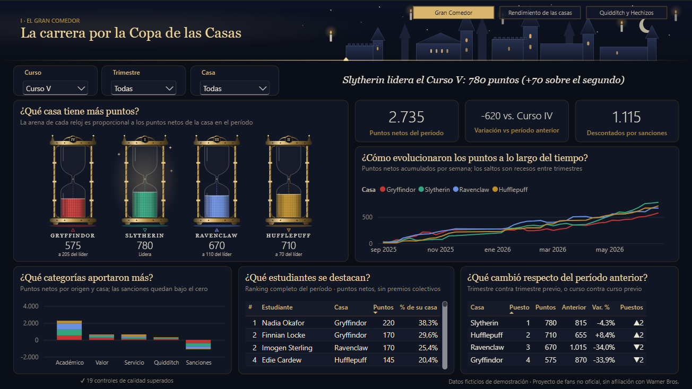

# Hogwarts BI · Proyecto Power BI

Versión de **Business Intelligence** de *Hogwarts — The Magical Data Experience*. Es un proyecto nativo de Power BI Desktop en formato **PBIX**. Incluye:

- un modelo estrella documentado;
- transformaciones en Power Query;
- 58 medidas DAX;
- un informe de 3 páginas con identidad visual propia, con tres visuales dinámicos dibujados con SVG generado por DAX: **relojes de arena**, **estandartes** y un **marcador de Quidditch**;
- una validación automatizada que compara cada medida con un cálculo independiente.

> **Proyecto de fans no oficial**, sin afiliación con Warner Bros. Entertainment, Wizarding World Digital ni los titulares de los derechos de Harry Potter. **Todos los datos son ficticios** y fueron generados para demostración: no representan información del canon.



---

## Abrir el proyecto

**Requisitos:** Power BI Desktop (versión de agosto de 2026 o posterior; probado con 2.158, Microsoft Store) en Windows.

1. Abrí `HogwartsBI.pbix` con doble clic (o *Archivo > Abrir* en Power BI Desktop). Los datos ya vienen cargados, así que no hace falta actualizar nada para explorarlo.
2. Explorá las tres páginas. Los segmentadores de Curso, Trimestre y Casa están sincronizados entre páginas, y el informe abre en el **Curso V**. El panel de filtros abre contraído (los segmentadores cubren el filtrado) y usa los colores del informe, definidos en el tema; se expande desde su flecha.

**Si querés actualizar desde los CSV de `data/`:** andá a *Inicio > Transformar datos > Editar parámetros* y en **RutaDatos** escribí la ruta completa de esa carpeta en tu equipo, terminada en `\`; después, *Actualizar*. Power BI no admite rutas relativas en los orígenes de archivo, por eso la carpeta se centraliza en un único parámetro.

## Actualizar los datos

Los CSV de `data/` son los datos ficticios de entrada del modelo. Vienen incluidos en el repositorio y no se editan a mano: fueron generados por un simulador determinista que no forma parte de este repositorio. Si reemplazás los CSV, hacé clic en *Actualizar* en Power BI Desktop y volvé a ejecutar la validación (ver abajo).

---

## Qué responde cada página

### I · Gran Comedor: la carrera por la Copa de las Casas
- **Titular dinámico:** quién lidera, en qué período y por cuánto.
- **¿Qué casa tiene más puntos?** Cuatro **relojes de arena**, uno por casa. La arena es proporcional a los puntos netos de la casa en el período, y cada reloj muestra el sigilo del elemento de la casa, el nombre, los puntos, el puesto y la distancia al líder (ver [Relojes de arena](#relojes-de-arena-cómo-funcionan)).
- **KPIs:** puntos netos del período, variación contra el período anterior (con el período comparado) y puntos descontados. Se quitaron "Casa líder" y "Ventaja del líder" porque ya los muestran los relojes y el titular.
- **¿Cómo evolucionaron los puntos?** Acumulado semanal; los recesos entre trimestres quedan visibles en el eje de fechas.
- **¿Qué categorías aportaron más?** Columnas apiladas por casa, con las sanciones bajo el cero.
- **¿Qué estudiantes se destacan?** Ranking completo del período con su puesto y el porcentaje que aportan a su casa (lista con desplazamiento: son todos los estudiantes).
- **¿Qué cambió respecto del período anterior?** Puntos, variación % y puestos ganados o perdidos (▲▼).

### II · Rendimiento de las casas
- **Estandartes de las casas:** cada casa con su color y el sigilo alquímico de su elemento (originales), más su puesto, puntos y variación contra el período anterior (▲▼). Es un SVG dinámico, igual que los relojes.
- **Evolución período a período:** puntos netos de cada trimestre.
- **¿Cómo cambió el ranking curso a curso?** Matriz de puestos con el campeón de cada curso resaltado (formato condicional con la medida `Color Fondo Puesto`). Esta interacción está configurada para **ignorar el segmentador de Curso** y mostrar siempre la historia completa.
- **¿Cómo se reparten los premios de cada casa?** 100 % por categoría.
- **¿Quiénes sostienen a cada casa?** Contribución de cada estudiante.
- **¿Dónde gana y dónde pierde cada casa?** Tablero con ganados, perdidos, netos, participación y distancia al líder.

### III · Quidditch y hechizos (análisis separados)
- Dos zonas con emblema propio (esfera alada para el Quidditch y libro abierto para la biblioteca) y un divisor ornamental entre ambas.
- **Quidditch · marcador mágico:** un marcador SVG dinámico (medida `Marcador de Quidditch (SVG)`) con la tabla de la Copa: puesto, partidos jugados, victorias, derrotas, puntos a favor y en contra, diferencia y Snitches, ordenada por la medida `Posición Copa Quidditch`. Al pie: partidos, partidos decididos por la Snitch, puntos por partido y los **tres máximos goleadores** del período. Debajo, todos los partidos del período con su marcador, la Snitch y si fue decisiva.
- **Biblioteca · grimorio:** búsqueda real de hechizos (segmentador con cuadro de búsqueda), lanzamientos, tasa de éxito y hechizos practicados; **dispersión** dificultad × tasa de éxito (un punto por hechizo, tamaño = lanzamientos, color = rama); tasa de éxito por rama con los mismos colores; y el catálogo completo. El titular resume la **correlación de Pearson** entre dificultad y éxito calculada en DAX.
- Qué se reemplazó y por qué: la tabla de la Copa y las tres tarjetas de Quidditch se integraron en el marcador, que muestra las mismas medidas. Las columnas "éxito por nivel de dificultad" se reemplazaron por la dispersión, que muestra la misma relación hechizo por hechizo y con el volumen de práctica.
- No se combinan métricas de ambos mundos en un mismo visual: miden fenómenos distintos.

---

## Estructura de la carpeta

```
Hogwarts-Bi/
├─ HogwartsBI.pbix                 ← abrir este archivo en Power BI Desktop
├─ data/                           CSV fuente (datos ficticios)
├─ tema/HogwartsBI.json            tema de Power BI (importable por separado)
├─ tema/recursos/                  SVG originales: cabecera con el castillo, emblemas y divisor (se registran en el informe)
├─ powerquery/                     cada consulta M en un archivo .pq
├─ dax/medidas.dax                 todas las medidas DAX
├─ docs/
│  ├─ modelo.md                    esquema, granularidad, relaciones y decisiones
│  ├─ diccionario_datos.md         tablas y columnas (generado)
│  ├─ medidas.md                   catálogo de medidas (generado)
│  └─ capturas/final/              capturas limpias del diseño final
├─ validacion/
│  ├─ casos.json                   consultas DAX + resultados esperados
│  └─ REPORTE_VALIDACION.md        comparación caso por caso
└─ scripts/                        casos de validación y referencias de los SVG (ver abajo)
```

## Scripts

| Script | Qué hace |
|---|---|
| `generar_casos_validacion.py` | Calcula en Python, a partir de los CSV, los resultados esperados de 47 casos (1.043 valores), incluidos los SVG de relojes, estandartes y marcador. |
| `svg_relojes.py`, `svg_estandartes.py`, `svg_marcador.py` | Implementaciones de referencia de los SVG dinámicos: sirven para diseñarlos (vista previa en el navegador) y como oráculo de las pruebas. |
| `comparar_validacion.py` | Compara esperado contra DAX y escribe `validacion/REPORTE_VALIDACION.md`. |

Los casos esperados (`validacion/casos.json`) y el resultado de la comparación (`validacion/REPORTE_VALIDACION.md`) están incluidos. Las consultas DAX de los casos se ejecutaron contra el motor local de Power BI Desktop.

> **Limitación de reproducibilidad:** el script que ejecuta esas consultas contra Power BI Desktop (PowerShell) y el archivo con sus resultados (`validacion/resultados_dax.json`) **no se incluyen** en este repositorio. Con lo que hay acá se puede regenerar el resultado esperado (`generar_casos_validacion.py`) y leer el reporte, pero no volver a ejecutar la comparación completa (`comparar_validacion.py` necesita esos resultados).

---

## Relojes de arena: cómo funcionan

**Implementación.** La medida `Relojes de Arena (SVG)` (carpeta *8. Visuales SVG*, categoría de datos *ImageUrl*) construye un SVG con los cuatro relojes y lo devuelve como `data:image/svg+xml`. El informe lo muestra en el visual **Imagen** nativo de Power BI, con la URL ligada a la medida mediante formato condicional. No hay imágenes estáticas con cifras superpuestas: la arena, los números, el puesto y el texto salen de las mismas medidas validadas.

**Por qué esta opción.** Antes de decidir se prototiparon cuatro variantes en una copia del proyecto, abierta en Power BI Desktop 2.158:

| Variante | Resultado |
|---|---|
| Visual Imagen con la URL ligada a la medida | ✅ Renderiza y responde a los filtros (elegida) |
| Visual Imagen con `imageUrl` general ligada a la medida | Sin resultado útil |
| Tabla con la medida como imagen | ❌ Impide cargar el informe completo en esta versión |
| SVG estático registrado | ✅ Funciona; se usa sólo para recursos decorativos (cabecera, emblemas) |

**Qué gobierna la arena.**
- Nivel de arena = 92 px × max(`Puntos Netos` de la casa, 0) / máximo positivo entre las cuatro casas. Las cámaras son cilíndricas en el tramo medido, así que **la altura es proporcional a los puntos**. La cámara superior queda vacía a propósito: hay una sola codificación.
- **Filtros que la afectan:** Curso y Trimestre (vía `DimTrimestre`) y cualquier filtro sobre los hechos. El segmentador de **Casa** no oculta relojes: la medida itera `ALL ( DimCasa )` para comparar siempre las cuatro casas, y atenúa las no seleccionadas.
- **Bordes cubiertos:**
  - una casa sin registros muestra "—" y "Sin anotaciones", con nivel 0;
  - los puntos negativos se dibujan con nivel 0 y se rotulan "Saldo negativo";
  - si ninguna casa tiene puntos positivos, la escala es 1, sin división por cero;
  - los empates comparten puesto y la punta.
- El puesto del medallón usa la misma regla que la medida `Posición`: ranking de competición con empates.

**Cómo se prueba.** `scripts/svg_relojes.py` es una implementación independiente en Python. Las pruebas comparan la salida DAX con esa referencia, carácter por carácter, en seis contextos:
- Curso V;
- Curso I + Invierno;
- todo el archivo;
- segmentador en Slytherin;
- una selección con casas sin registros;
- una selección donde todas las casas tienen saldo negativo.

Además, el SVG incluye atributos `data-puntos`, `data-nivel` y `data-puesto` para inspeccionarlo. Los estandartes siguen el mismo esquema (`svg_estandartes.py`, cuatro contextos).

**Accesibilidad.** El visual tiene texto alternativo dinámico (medida `Relojes de Arena (descripción)`), y las mismas cifras están en la tabla "¿Qué cambió respecto del período anterior?".

**Marcador de Quidditch.** Mismo esquema: `scripts/svg_marcador.py` es la referencia y la medida `Marcador de Quidditch (SVG)` la reproduce carácter por carácter. Reutiliza sólo medidas existentes (`Partidos Jugados`, `Victorias`, `Derrotas`, `Puntos a Favor`, `Puntos en Contra`, `Snitches Atrapadas`, `Posición Copa Quidditch`, `Partidos`, `Partidos Decididos por la Snitch`, `Puntos por Partido` y `Goles`). Bordes: una casa sin partidos en el período muestra "—" y va al final; sin partidos en absoluto, un aviso explícito; con el segmentador de casa, las demás se atenúan; los goleadores empatados se desempatan por nombre. Texto alternativo: `Marcador de Quidditch (descripción)`.

---

## Validación: qué se construyó, qué se ejecutó y qué se verificó

**Validaciones automáticas, ejecutadas y aprobadas:**
- **Modelo:** se deserializa sin errores con la biblioteca de Microsoft incluida en Power BI Desktop 2.158 (13 tablas, 15 relaciones).
- **Informe:** los 61 archivos de definición validan contra los esquemas oficiales de `microsoft/json-schemas`, incluidos los 54 visuales.
- **Tema:** valida contra el esquema de temas 5.77 que trae la versión instalada de Desktop.
- **Medidas y Power Query:**
  - el proyecto se abrió en Power BI Desktop;
  - se actualizó el modelo completo, con todas las consultas M ejecutadas;
  - se ejecutaron 47 consultas DAX contra el motor local de Desktop.
  
  El resultado: **1.043 valores comparados contra un cálculo independiente en Python, 0 diferencias**. Entre ellos, los SVG completos de relojes, estandartes y marcador, comparados carácter por carácter. Ver [`validacion/REPORTE_VALIDACION.md`](validacion/REPORTE_VALIDACION.md).
- **Calidad de datos:** los 19 controles de `ControlCalidad` dan 0 filas con problema.

**Verificado dentro de Power BI Desktop:**
- El informe abre, muestra sus 3 páginas y los 54 visuales se renderizan sin errores de campos. Capturas limpias (sólo la página, sin paneles) en `docs/capturas/final/`.
- Se abrió el informe en Desktop con ocho estados fijados en los segmentadores: Curso V (las tres páginas); Curso I + Invierno + Ravenclaw (Gran Comedor y Quidditch: las demás casas se atenúan, Hufflepuff sin partidos); todos los cursos (Gran Comedor y Rendimiento: "Sin período previo"); Curso I + Otoño (Gryffindor sin partidos: fila "—" al final del marcador).
- Los estados de borde que no aparecen en los datos reales (todas las casas con saldo negativo, ningún partido, empates) se verificaron por DAX contra la referencia de Python.
- Las cifras visibles coinciden con las de los CSV; por ejemplo, Curso V: Slytherin 780, Hufflepuff 710, Ravenclaw 670, Gryffindor 575.
- La selección inicial (Curso V) y la sincronización de segmentadores entre páginas funcionan.

**Un error real que encontró la validación visual:** la primera versión de las medidas de ranking iteraba `ALL ( DimCasa[CasaKey] )`. Las pruebas DAX agrupaban por la clave y daban bien, pero los visuales agrupan por el nombre de la casa: ese filtro sobrevivía a la transición de contexto y todas las casas quedaban "primeras". Se corrigió con `ALL ( DimCasa )` y se agregaron casos que consultan igual que los visuales.

**No verificado:**
- La interacción manual con clics en Desktop: cambiar los segmentadores a mano, **escribir en la búsqueda de hechizos**, los tooltips al pasar el cursor y la sincronización al cambiar de página. Sí se verificaron por DAX los mismos contextos de filtro, y el informe se vio en Desktop con ocho selecciones fijadas en los segmentadores.
- El renderizado de los SVG dinámicos en el servicio Power BI o en la app móvil: sólo se verificó en Desktop. El texto de los SVG usa Georgia y Segoe UI; en equipos sin esas fuentes se usa una alternativa.
- El diseño para la vista móvil del informe (no se configuró).
- La publicación en el servicio Power BI (no hacía falta; requiere una cuenta).
- Power BI Desktop en versiones anteriores a 2.158. Los esquemas usados (visualContainer 2.12.0, report 3.3.0) corresponden a agosto de 2026; una versión más antigua podría no abrir el informe.

---

## Qué demuestra este proyecto

- **Modelo dimensional:** estrella con un copo de nieve en el tiempo (trimestre → semana), granos explícitos, relaciones 1:N de dirección única, sin ambigüedad y sin columnas calculadas en DAX.
- **Power Query:** una sola conexión parametrizada, tipado independiente de la configuración regional, catálogos que detienen la carga ante códigos desconocidos, paso de formato ancho a largo y tratamiento explícito de valores faltantes.
- **DAX:** rankings con empates, período anterior en un calendario escolar no estándar, acumulados independientes del eje, `TREATAS`, correlación de Pearson y titulares dinámicos.
- **Calidad de datos:** 19 controles dentro del modelo, visibles en el propio informe.
- **Validación:** 47 casos (1.043 valores) comparados contra un cálculo independiente en Python. La ejecución de las consultas DAX se hizo localmente; ese paso no se puede reproducir desde este repositorio (ver la limitación en la sección de scripts).
- **Python como apoyo:** generación de los casos de validación y referencias de los SVG dinámicos (los cinco scripts de `scripts/`).
