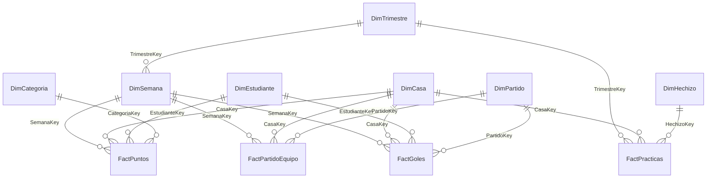

# Modelo de datos

> Datos ficticios de demostración. Proyecto de fans no oficial.

## Origen y principio rector

El modelo se alimenta de los CSV de `data/` y no recalcula nada de la fuente: los totales del informe son los de los datos de entrada. Por ejemplo, Curso V: Slytherin 780, Hufflepuff 710, Ravenclaw 670, Gryffindor 575.

La única información nueva es el **calendario con fechas**, un supuesto de la capa BI: el Curso I corresponde al año escolar 2021-22, y los trimestres empiezan el primer lunes de septiembre, el primer lunes de enero y 13 semanas después. La web sólo tiene curso y semana.

## Esquema

Estrella con un copo de nieve en el tiempo (trimestre → semana). Todas las relaciones son **uno a muchos, de dirección única**, sin relaciones muchos a muchos ni bidireccionales.

## Tablas y granularidad

| Tabla | Tipo | Grano (una fila =) | Filas |
|---|---|---|---|
| DimTrimestre | Dimensión (tiempo) | un trimestre de un curso | 15 |
| DimSemana | Dimensión (tiempo) | una semana escolar | 180 |
| DimCasa | Dimensión | una casa | 4 |
| DimEstudiante | Dimensión | un estudiante (+ miembro "(colectivo)") | 49 |
| DimCategoria | Dimensión | un origen de puntos | 5 |
| DimHechizo | Dimensión | un hechizo | 33 |
| DimPartido | Dimensión | un partido de Quidditch | 30 |
| FactPuntos | Hechos | una anotación de puntos (premio o sanción) | 1.709 |
| FactPartidoEquipo | Hechos | un equipo en un partido | 60 |
| FactGoles | Hechos | un goleador en un partido | 157 |
| FactPracticas | Hechos | curso × trimestre × casa × hechizo | 1.980 |
| ControlCalidad | Auxiliar | un control de calidad | 19 |
| _Medidas | Contenedor | — (sólo medidas) | 0 |

El detalle de cada columna está en el [diccionario de datos](diccionario_datos.md).

## Decisiones de modelado

**El tiempo a nivel semana, no día.** Los hechos ocurren por semana escolar; ningún dato tiene día. Una tabla diaria multiplicaría por 7 las filas sin aportar información y habilitaría análisis diarios engañosos. Por eso las comparaciones de período usan índices propios (`IndiceTrimestre`, `SemanaGlobal`) en lugar de la inteligencia de tiempo estándar, pensada para calendarios civiles. También se desactivó la fecha/hora automática (`__PBI_TimeIntelligenceEnabled = 0`) para no generar tablas de fechas ocultas.

**El copo de nieve trimestre → semana.** Las prácticas de hechizos no tienen semana, sólo trimestre. En lugar de inventarles una semana, FactPracticas se relaciona con DimTrimestre y los demás hechos con DimSemana. Un solo segmentador de Curso o Trimestre filtra los cuatro hechos de forma coherente.

**FactPartidoEquipo con dos filas por partido.** Los partidos llegan en formato ancho (local y visitante en una fila). Power Query los pasa a una fila por equipo, y así las victorias, derrotas y puntos por casa son sumas simples. Para no contar dos veces cada partido, la medida `Partidos` usa `DISTINCTCOUNT` de la clave del partido.

**Sin relación entre DimEstudiante y DimCasa.** Si existiera, habría dos caminos de DimCasa a FactPuntos (directo y a través del estudiante), es decir, ambigüedad. La casa del estudiante queda como atributo. Cuando hace falta cruzarla, la medida `% Contribución a la Casa` usa `TREATAS`.

**DimPartido no se relaciona con el calendario,** por el mismo motivo: crearía un segundo camino de filtro hacia FactPartidoEquipo y FactGoles.

**Claves naturales para casas, estudiantes y hechizos.** Son códigos estables de la fuente y de baja cardinalidad. Una clave sustituta no agregaba valor y obligaba a hacer combinaciones extra en Power Query. El tiempo sí usa claves enteras calculadas (`Curso × 100 + Semana`).

**Valores faltantes con significado.** Los premios por victorias de Quidditch no tienen estudiante. En lugar de dejar la clave vacía, se asignan al miembro explícito "(colectivo)", que las medidas de estudiantes excluyen. Si un equipo no aparece en `goles.csv` es porque no convirtió, y sus goles se completan con 0.

**Columnas para mostrar separadas de la lógica.** Por ejemplo, `Snitch Decisiva` (lógico, oculta) se usa en filtros DAX, y `¿Decidió la Snitch?` ("Sí"/"No") se muestra en las tablas.

**Sin columnas calculadas DAX.** Todos los atributos derivados (etiquetas, órdenes, banderas, claves) se crean en Power Query, donde se documentan y se comprimen mejor. La lógica de agregación vive sólo en medidas.

## Power Query

Todas las consultas leen sus archivos con `fnLeerCsv`, que a su vez parte de una **única conexión**: la carpeta `RutaDatos` (`Folder.Files`). Al haber un solo origen, combinar archivos no genera conflictos de niveles de privacidad.

| Transformación | Dónde | Por qué |
|---|---|---|
| Tipos con cultura `en-US` | todas las tablas | Los CSV usan punto decimal y fechas ISO; así la carga no depende de la configuración regional del equipo |
| `Text.Trim` y celda vacía → `null` | `fnLeerCsv` | Un valor faltante es `null`, no texto vacío; evita claves "fantasma" |
| Claves en minúscula | dimensiones y hechos | Normaliza los códigos antes de relacionar |
| Catálogos controlados (categorías, ramas, trimestres) | DimCategoria, DimHechizo, DimTrimestre | Un código desconocido **detiene la actualización** con un mensaje claro en lugar de clasificar mal |
| Formato ancho → largo | FactPartidoEquipo | Una fila por equipo y partido |
| `Table.Distinct` sobre la clave | dimensiones y FactPuntos | Protege la relación uno a muchos. Los duplicados de origen no se ocultan: se cuentan en ControlCalidad |
| Semanas derivadas de los trimestres | DimSemana | Una sola definición del calendario |

El código de cada consulta está en [`powerquery/`](../powerquery/).

## Calidad de datos

La tabla **ControlCalidad** se recalcula en cada actualización con 19 controles: unicidad de claves en los archivos fuente, integridad referencial de los cuatro hechos y reglas de negocio. Entre las reglas:

- el marcador es igual a 10 × goles + 150 si la casa atrapó la Snitch;
- cada partido tiene exactamente una victoria;
- cada victoria tiene su premio de +50 en el libro de puntos, y cada premio tiene su victoria;
- cada goleador jugó para su casa;
- los éxitos van de 0 a la cantidad de intentos.

El informe muestra el resultado ("✔ 19 controles de calidad superados") con la medida `Estado de Calidad`.

## Medidas

Hay 58 medidas explícitas en la tabla `_Medidas`, organizadas en carpetas: Puntos, Ranking, Comparación temporal, Estudiantes, Quidditch, Hechizos, Formato y textos, Visuales SVG, Calidad de datos. Ver el [catálogo](medidas.md) y el [código](../dax/medidas.dax). Hay tres decisiones a destacar:

- **Rankings:** `RANKX` sobre `ALL ( DimCasa )`, con la tabla completa. Iterar sólo la clave dejaba vivo el filtro por nombre de casa que agregan los visuales, y cada casa quedaba primera. La validación detectó ese error y quedó cubierto por un caso de prueba.
- **Período anterior:** si el contexto es un único trimestre, compara con el trimestre previo, aunque sea de otro curso. Si es un curso, compara con el curso previo con los mismos trimestres seleccionados. Devuelve 0 cuando el período anterior existe sin anotaciones, y vacío cuando no hay período anterior.
- **Acumulados:** `ALLSELECTED ( DimSemana )` quita los filtros del eje, sea cual sea la columna que se use (clave o fecha), y conserva los segmentadores.
- **Visuales SVG:** relojes de arena, estandartes y marcador de Quidditch son medidas que devuelven un SVG (categoría *ImageUrl*). Reutilizan medidas existentes (`Puntos Netos`, `Variación vs Período Anterior`, las de Quidditch y `Goles`), iteran `ALL ( DimCasa )` y no agregan lógica de negocio nueva: sólo presentación. El SVG nunca representa una cifra distinta de la que se muestra.
